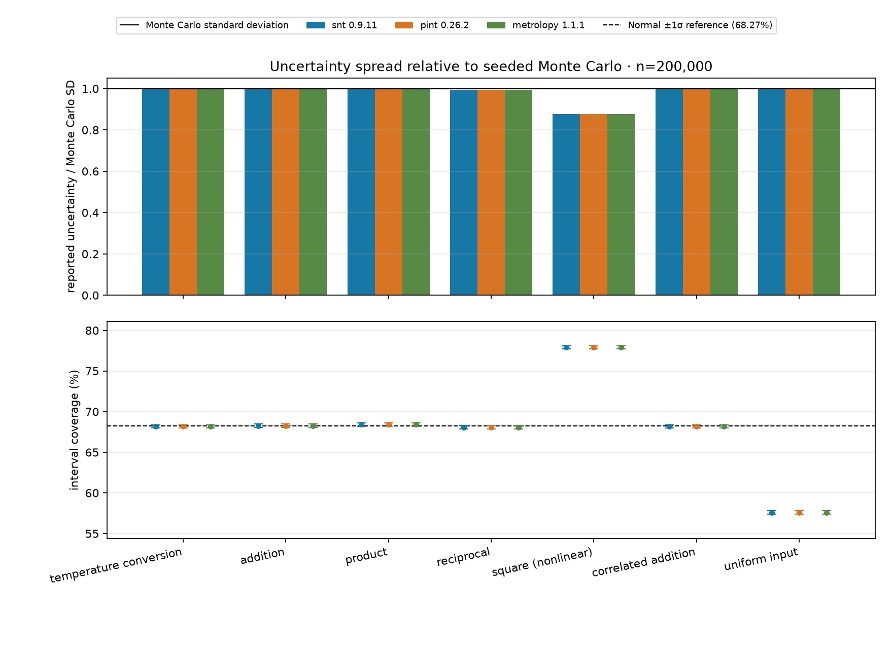
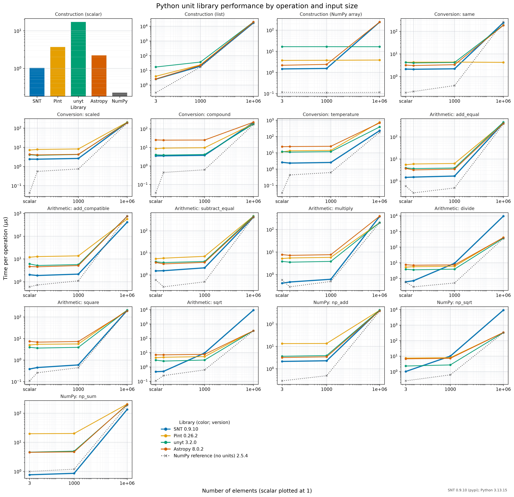
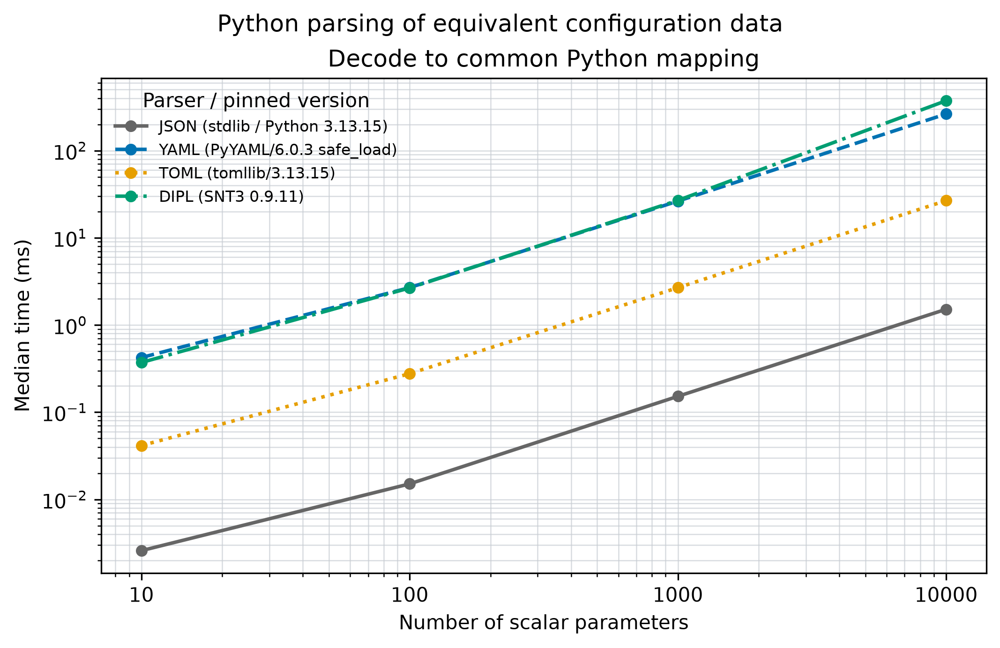
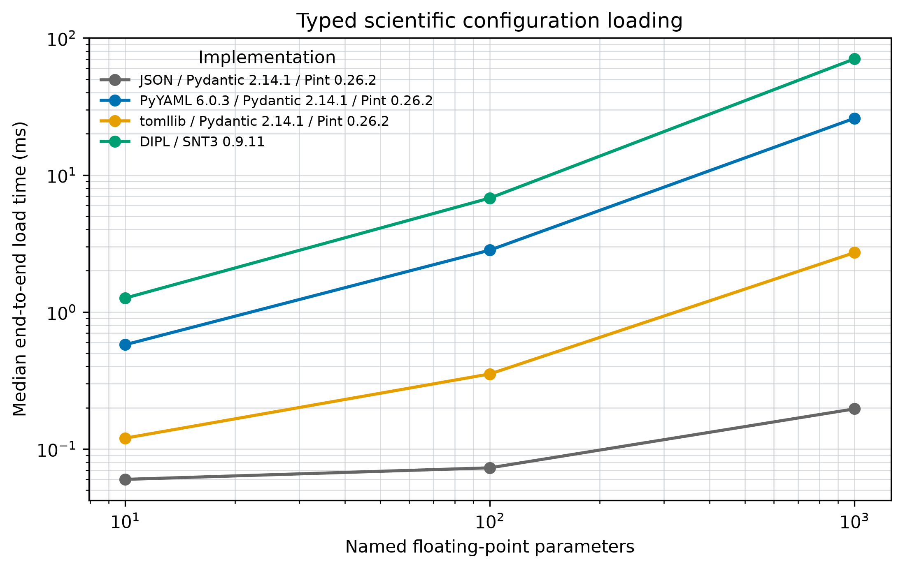
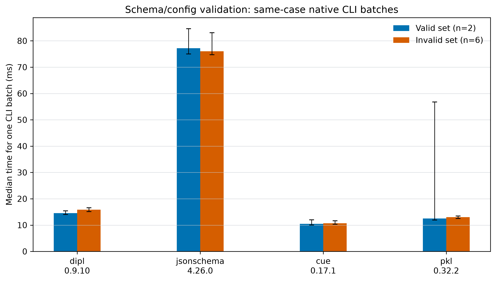
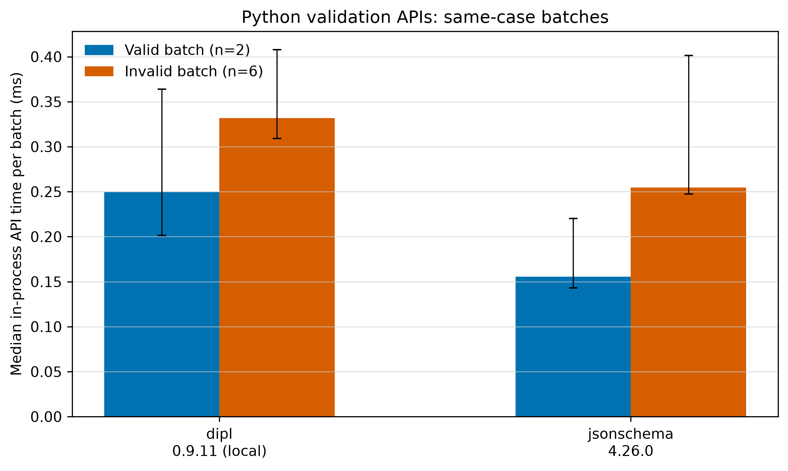

# SNT Benchmarks

Official benchmark and comparison repository for [SciNumTools3 (SNT3)](https://github.com/scinumtools/snt3).

## Benchmarks

- [Unit conversion accuracy](benchmarks/unit-conversion-accuracy/README.md)
- [Uncertainty propagation](benchmarks/uncertainty-propagation/README.md)
- [Python physical units](benchmarks/pyunits/README.md)
- [Python configuration parsing](benchmarks/pyserial/README.md)
- [Typed configuration loading](benchmarks/typed-config/README.md)
- [Schema and configuration validation](benchmarks/schema-validation/README.md)

## Unit conversion accuracy

Binary64 conversion error for five representative conversions, measured against
exact rational references. Results report ULP distance and relative error for
the pinned unit-library releases.

[Methods, full results, and run instructions](benchmarks/unit-conversion-accuracy/README.md).

## Uncertainty propagation

Configured unit-uncertainty cases compared with first-order analytical
propagation and seeded Monte Carlo estimates. The plot compares reported uncertainty with seeded Monte Carlo spread and shows interval coverage.

[Methods, full results, and run instructions](benchmarks/uncertainty-propagation/README.md).

## Python physical units

Comparison of SNT3, Pint, unyt, and Astropy unit operations across scalar and array sizes. The figure shows median time per operation, with pinned library versions in the legend; NumPy is included as a unitless baseline.

The workload categories are informed by [Goldbaum et al.'s unit-library benchmark (2018)](https://doi.org/10.21105/joss.00809).

[Methods, quick results, GitHub Actions pyperf screen, and run instructions](benchmarks/pyunits/README.md).

## Python configuration parsing

Comparison of JSON, YAML, TOML, and DIPL for equivalent nested data. The parser-only figure measures each decoder's native result; the common-mapping figure also converts DIPL's evaluated nodes to a standard Python mapping. At 10,000 parameters, this conversion adds about 7.6% to DIPL's measured time, while DIPL is already slower in parser-only mode. Parser versions appear in the legends.

The method follows the equivalent-structure and equality-check pattern in [Canop's configuration deserializer benchmark](https://github.com/Canop/bench-config-deserializers).

[Methods, full results, and run instructions](benchmarks/pyserial/README.md).

## Typed configuration loading

End-to-end loading of equivalent scientific settings, including typed validation, defaults, derived values, and unit-bearing values. At 1,000 parameters, DIPL takes 70.4 ms, versus 25.9 ms for YAML + Pydantic + Pint, 2.71 ms for TOML + Pydantic + Pint, and 0.196 ms for JSON + Pydantic + Pint. DIPL provides the model behavior natively, but this run shows its runtime cost rather than a speed advantage.

[Methods, full results, and run instructions](benchmarks/typed-config/README.md).

## Schema and configuration validation

Feature support and validation timing for DIPL, JSON Schema, CUE, and Pkl, with capabilities linked to primary project documentation. The CLI figure shows all four participants; the in-process figure isolates the Python APIs for DIPL and JSON Schema. In the latest local SNT3 run, DIPL's batch times are relatively close to JSON Schema's, though still higher. The two methods use different timing scopes and should be compared separately.

[Feature matrix, methods, analysis, and full results](benchmarks/schema-validation/README.md).

