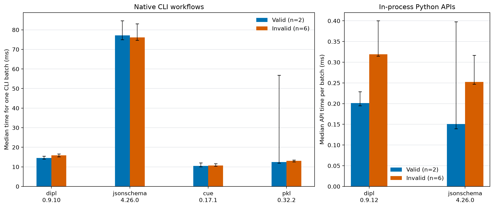

# SNT Benchmarks

Official benchmark and comparison repository for [SciNumTools3 (SNT3)](https://github.com/scinumtools/snt3).

All published figures and results use the pinned versions recorded with each benchmark. Local SNT3 checkouts are for debugging and are not used for the published references.

## Benchmarks

- [Unit conversion accuracy](benchmarks/unit-conversion-accuracy/README.md)
- [Uncertainty propagation](benchmarks/uncertainty-propagation/README.md)
- [Python physical units](benchmarks/pyunits/README.md)
- [Python configuration parsing](benchmarks/pyserial/README.md)
- [Typed configuration loading](benchmarks/typed-config/README.md)
- [Schema and configuration validation](benchmarks/schema-validation/README.md)

## Unit conversion accuracy

Binary64 conversion error for five representative conversions, measured against
exact rational references. Results report ULP distance and relative error for
the pinned unit-library releases.

[Methods, full results, and run instructions](benchmarks/unit-conversion-accuracy/README.md).

## Uncertainty propagation

Configured unit-uncertainty cases compare first-order propagation with seeded
Monte Carlo estimates. All three libraries appear in the fast track; SNT3 0.9.12
and MetroloPy also report Monte Carlo propagation with central 95% intervals.

[Methods, full results, and run instructions](benchmarks/uncertainty-propagation/README.md).

## Python physical units

Comparison of SNT3, Pint, unyt, and Astropy unit operations across scalar and array sizes. The figure shows median time per operation, with pinned library versions in the legend; NumPy is included as a unitless baseline.

The workload categories are informed by [Goldbaum et al.'s unit-library benchmark (2018)](https://doi.org/10.21105/joss.00809).

[Methods, quick results, GitHub Actions pyperf screen, and run instructions](benchmarks/pyunits/README.md).

## Python configuration parsing

Comparison of JSON, YAML, TOML, and DIPL for equivalent nested data. At 10,000
parameters, DIPL takes 141.7 ms to parse and 160.5 ms to also build a common
Python mapping. SNT3 0.9.12 reduces DIPL's parser-only median by about 59% versus
the preceding quick snapshot; TOML and JSON remain faster in this workload.

The method follows the equivalent-structure and equality-check pattern in [Canop's configuration deserializer benchmark](https://github.com/Canop/bench-config-deserializers).

[Methods, full results, and run instructions](benchmarks/pyserial/README.md).

## Typed configuration loading

End-to-end loading of equivalent scientific settings, including typed validation,
defaults, derived values, and unit-bearing values. At 1,000 parameters, DIPL takes
8.62 ms, versus 25.5 ms for YAML + Pydantic + Pint, 2.69 ms for TOML + Pydantic
+ Pint, and 0.196 ms for JSON + Pydantic + Pint. In this run DIPL is about 3×
faster than the YAML stack and slower than TOML and JSON.

[Methods, full results, and run instructions](benchmarks/typed-config/README.md).

## Schema and configuration validation

Feature support and validation timing for DIPL, JSON Schema, CUE, and Pkl, with capabilities linked to primary project documentation. The native CLI panel shows the retained four-participant SNT CLI 0.9.10 snapshot; the in-process panel shows the refreshed DIPL/SNT3 0.9.12 and JSON Schema results. The panels use different scopes and should be compared separately.

[Feature matrix, methods, analysis, and full results](benchmarks/schema-validation/README.md).

