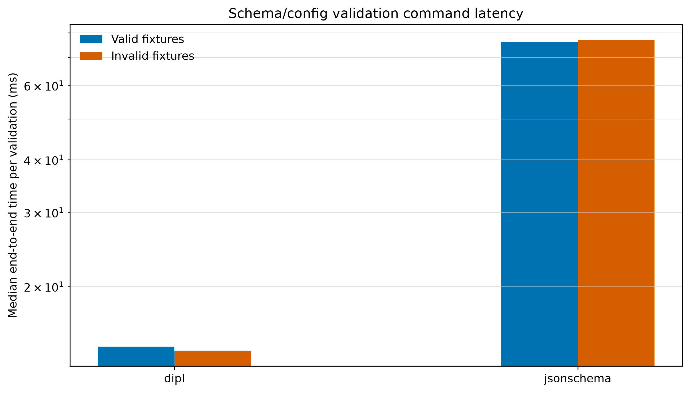

# SNT Benchmarks

Official benchmark and comparison repository for [SciNumTools3 (SNT3)](https://github.com/scinumtools/snt3).

## Benchmarks

- [Python physical units](benchmarks/pyunits/README.md)
- [Python configuration parsing](benchmarks/pyserial/README.md)
- [Schema and configuration validation](benchmarks/schema-validation/README.md)

## Python physical units

Comparison of SNT3, Pint, unyt, and Astropy unit operations across scalar and array sizes. The figure shows median time per operation, with pinned library versions in the legend; NumPy is included as a unitless baseline.

The workload categories are informed by [Goldbaum et al.'s unit-library benchmark (2018)](https://doi.org/10.21105/joss.00809).

[Methods, full results, and run instructions](benchmarks/pyunits/README.md).

## Python configuration parsing

Comparison of JSON, YAML, TOML, and DIPL parsing for equivalent nested data. The figure shows median decode time by parameter count and encoded document size, with parser versions in the legend.

The method follows the equivalent-structure and equality-check pattern in [Canop's configuration deserializer benchmark](https://github.com/Canop/bench-config-deserializers).

[Methods, full results, and run instructions](benchmarks/pyserial/README.md).

## Schema and configuration validation

Feature support comparison for DIPL, JSON Schema, CUE, and Pkl, with each capability linked to primary project documentation. The initial one-sample run shows CLI timings for DIPL and JSON Schema; the shared fixtures exposed a CUE mismatch on valid inputs, so no cross-tool timing claim is made yet.

[Feature matrix, methods, analysis, and full results](benchmarks/schema-validation/README.md).

