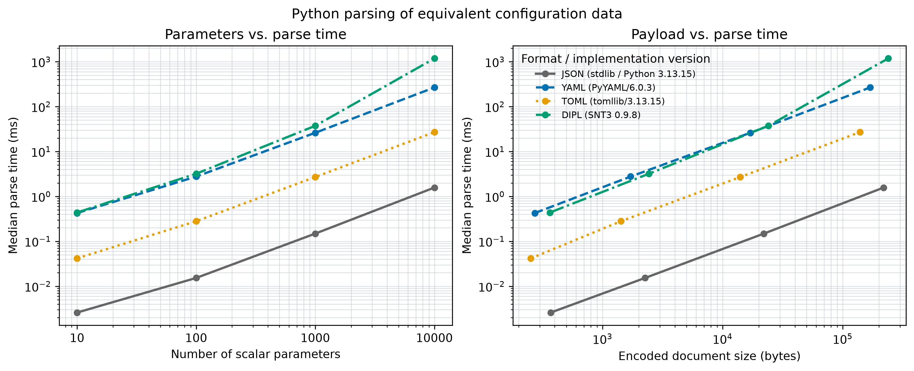

# Python configuration parsing

This benchmark compares four Python decode paths for the same nested `experiment` mapping: standard-library [`json.loads`](https://docs.python.org/3.13/library/json.html), [PyYAML](https://pyyaml.org/)'s `safe_load`, standard-library [`tomllib.loads`](https://docs.python.org/3.13/library/tomllib.html), and SNT3's [`DIP.parse`](https://github.com/scinumtools/snt3). Its method follows the shared-structure and equality-check pattern in [Canop's configuration deserializer benchmark](https://github.com/Canop/bench-config-deserializers); the data and Python parsers here are a separate comparison. The mapping contains a string, Boolean, integer, float, and a configurable number of named float parameters. All four decoders must reproduce the canonical Python mapping exactly before their timings are recorded.

The [DIPL settings](config.dip) govern the parameter counts, selected formats, experiment values, generated parameter names and values, timing, output paths, figure resolution, and pinned package versions. Project websites and method links are kept there as provenance. Python version and package pins are read from the DIP during environment setup; `benchmark.py` then uses `scinumtools3.dip.DIP` to read the selected configuration. Command-line options override selected settings for one run.

## Run

From the repository root:

```sh
./setup.sh --benchmark pyserial
./setup.sh --benchmark pyserial --size 10 --size 100 --format json --format dipl
./setup.sh --benchmark pyserial --samples 7 --target-ms 20
./setup.sh --benchmark pyserial --config path/to/custom.dip
```

The first run creates an isolated Python environment and installs the versions in `config.dip`. `--python PATH` selects a prepared interpreter whose installed versions match the DIP. Each run writes a timestamped CSV, figure, and effective configuration snapshot to the configured results directory. The smallest generated document for each selected format is written to [`documents/`](documents/) when `execution.outputs.export_smallest` is true.

## What is measured

Document generation occurs before timing. Each timed call decodes an in-memory string; DIPL additionally reads evaluated leaf nodes into the common Python mapping. This is a **decode-to-common-structure** comparison of these implementations. It does not isolate parser internals, include disk I/O, or test DIPL units, constraints, references, and derived expressions. Encoded byte counts are reported to make document-size differences visible.

The default quick method uses two warmups and five samples per format and size, calibrating loops toward 10 ms per sample. A decode longer than the target is timed once per sample. Medians and interquartile ranges appear in the CSV. The [reference results](results/README.md) and figure are from one macOS arm64 process; they are an initial comparison, and measurements on other hardware or independent processes may differ.

## Reference figure and analysis



The figure legend names each parser and shows its pinned package version; the standard-library parsers are labeled with the Python version.

The [full CSV](results/reference-quick.csv) and [effective configuration](results/reference-quick.config.json) contain the measurements and environment for this figure.

All 16 format-and-size cases in this reference passed exact equality checks. JSON has the lowest median at all four parameter counts in this run. At 10,000 parameters, the medians are 1.58 ms for JSON, 27.01 ms for TOML, 266.84 ms for YAML, and 1.182 s for DIPL. The encoded documents at that size range from 139 kB for TOML to 239 kB for DIPL. DIPL's timed path includes evaluating typed nodes and extracting them into the shared Python mapping, so the result includes more work than a direct dictionary decode. The DIPL case also had a 59 ms interquartile range at 10,000 parameters. Treat these as measurements of the selected parsers and workload on one machine, not a general ranking of the data formats.
