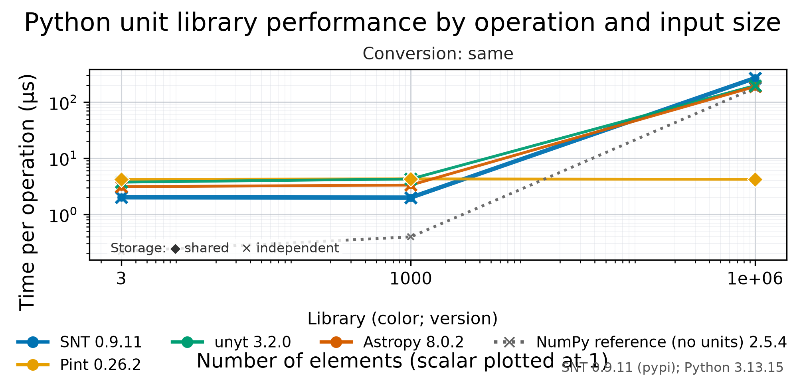
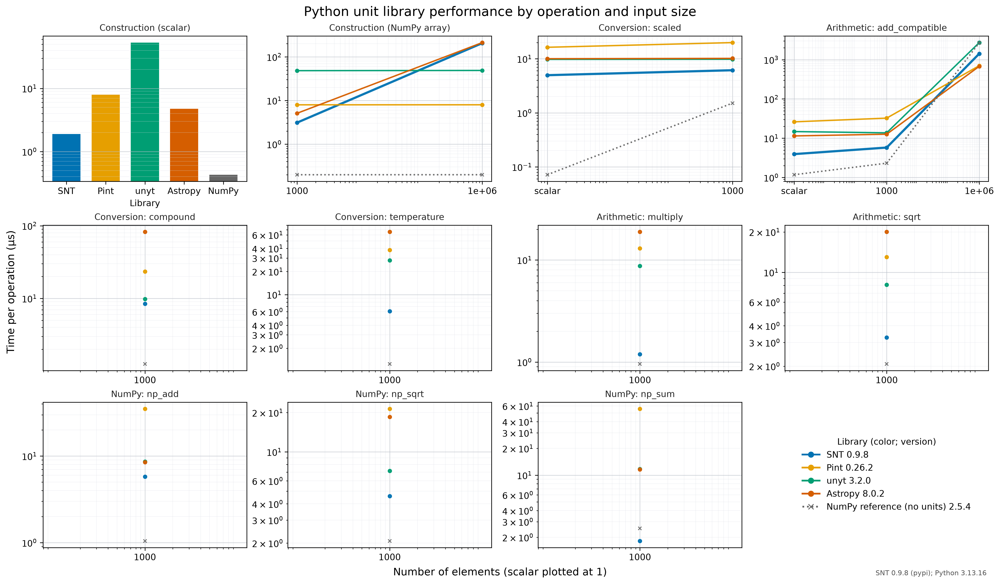

# Python unit-library comparison

The suite has two comparisons. `compare.py` measures scalar add-and-convert and 100,000-element array construction-and-conversion workloads, using the reference expression from [SNT3 revision `2e7fde7`](https://github.com/scinumtools/snt3/tree/2e7fde7c8e38d6224c620190e1a5848c2588da04). `matrix.py` covers quantity construction, unit conversion, arithmetic, and NumPy calls across scalar, short-array, and large-array inputs. The matrix categories follow the approach of [Goldbaum et al. (2018)](https://doi.org/10.21105/joss.00809), which benchmarks applying units to data, arithmetic, NumPy operations, and increasing input sizes. This suite uses its own workloads and pinned library versions; it is not a reproduction of that study. The tested operations and units are defined in the scripts so that each library performs equivalent work.

## Run

From this repository's root:

```sh
./setup.sh                                      # pinned SNT3, quick full matrix
./setup.sh --mode pyperf                        # repeated worker-process run
./setup.sh --mode pyperf --profile ci           # representative, shorter CI-style subset
./setup.sh --source local --mode quick          # neighboring SNT3 checkout
./setup.sh --list-cases                         # IDs available for reruns
./setup.sh --case 'conversion/scaled/scalar/1' --library snt --library pint
./setup.sh --benchmark pyunits-basic            # scalar/array comparison
./setup.sh --benchmark pyunits-basic --library snt --library sympy
```

The runner creates `.venv-pinned` or `.venv-local` in this directory on first use and installs the versions from [config.dip](config.dip). Pinned mode uses Python 3.13 by default. Local mode expects a built binding in `../scinumtools3/build/python/scinumtools3` and creates its environment from that checkout's `.venv/bin/python`, so the extension ABI matches. Set `SNT_LOCAL_REPO` for another checkout. Use `--python PATH` or `PYTHON=PATH` to use an already prepared environment; the runner checks its versions and does not install into it.

Edit [config.dip](config.dip) to change the source, timing mode, array sizes, selected cases and libraries, input values, correctness tolerances, quick timing controls, pyperf controls, scalar/array workload controls, and pinned versions. `execution.selection.libraries` controls the matrix; `execution.selection.basic_libraries` controls the basic comparison. Command-line flags override the corresponding settings for one run. Changing a version in the DIP file changes the environment created by the runner. `pyunits.execution.paths` controls interpreter and output locations. Package websites and the reference revision are provenance fields recorded with results; they do not alter measurements. Every value has a DIPL description. The runner writes an effective `.config.json` with the DIP file hash, overrides, versions, websites, and command next to every completed run.

`compare.py` and `matrix.py` also read their defaults from the selected DIP file when invoked directly with `--config PATH`. Their command-line values override the DIP. The memory probe receives the matrix input range explicitly.

## Case IDs

The operation matrix case ID has four slash-separated parts:

```text
group/operation/input_kind/elements
```

`group` names the kind of work, `operation` names the specific operation, `input_kind` says whether the input is a scalar, Python list, or NumPy array, and `elements` is the number of values. Scalar cases always use `1`; array sizes come from `execution.selection.sizes` in [`config.dip`](config.dip). For example, `conversion/compound/ndarray/1000` converts a 1,000-element quantity from metres per second to kilometres per hour. `--list-cases` prints the IDs generated for the current configured sizes, and `--case` accepts shell-style glob patterns over the full ID (for example, `arithmetic/*/scalar/1`).

| `group` | `operation` values | What the operation does |
|---|---|---|
| `construction` | `attach_units` | Construct a quantity in metres from a scalar, Python list, or NumPy array. |
| `conversion` | `same` | Convert metres to metres. |
|  | `scaled` | Convert metres to millimetres. |
|  | `compound` | Convert metres per second to kilometres per hour. |
|  | `temperature` | Convert degrees Celsius to kelvin, using temperature-aware conversion where required. |
| `arithmetic` | `add_equal` | Add two metre quantities. |
|  | `add_compatible` | Add metres to an equivalent quantity in centimetres. |
|  | `subtract_equal` | Subtract one metre quantity from another. |
|  | `multiply` | Multiply metres by seconds, producing metre-seconds. |
|  | `divide` | Divide metres by seconds, producing metres per second. |
|  | `square` | Multiply a metre quantity by itself, producing square metres. |
|  | `sqrt` | Take the square root of a square-metre quantity, producing metres. |
| `numpy` | `np_add` | Add two metre quantities with `numpy.add`. |
|  | `np_sqrt` | Take the square root of a square-metre quantity with `numpy.sqrt`. |
|  | `np_sum` | Sum an array of metre quantities with `numpy.sum`. |

`input_kind` is `scalar` for one value; `list` is used only for list-based construction; `ndarray` is used for array construction, conversions, arithmetic, and NumPy operations. The separate `pyunits-basic` run is a macro workload rather than an operation-matrix case list: its records use `scalar/add_and_convert` (repeatedly add metre and US-foot quantities, then convert to US inches) and `array/construct_and_convert` (construct an array quantity in metres and convert it to millimetres).

## Feature support and benchmark coverage

This matrix follows the feature-comparison style of [SocialCompare's Python units table](https://socialcompare.com/en/comparison/python-units-quantities-packages), but records pinned releases and links to project documentation instead of time-varying popularity statistics. `✓` means the capability is described in the linked docs; `◐` means it depends on an optional integration or has a narrower/different meaning; `—` means the feature is unavailable in the compared API or the package documents a different model; `?` means I did not verify it in the cited docs. A `?` is not a claim that a feature is impossible. The SNT wheel is pinned at 0.9.11; because PUEL specifications are not versioned with that wheel, SNT links point to the immutable source snapshot [`2870ef8`](https://github.com/scinumtools/snt3/tree/2870ef83df9f223ef1fcc13a0145cd7b4d0d8ad6). The other documentation links use the pinned versions from [`config.dip`](config.dip) where available.

| Feature | [SNT3 0.9.11](https://pypi.org/project/scinumtools3/0.9.11/) | [Pint 0.26.2](https://pint.readthedocs.io/en/0.26.2/) | [unyt 3.2.0](https://unyt.readthedocs.io/en/3.2.0/) | [Astropy 8.0.2](https://docs.astropy.org/en/8.0.2/) | [SymPy 1.14.0](https://docs.sympy.org/1.14.0/) | Tested in this suite |
|---|---|---|---|---|---|---|
| Built-in unit catalogs and unit systems | [✓ SI, CGS, English, and natural systems](https://github.com/scinumtools/snt3/blob/2870ef83df9f223ef1fcc13a0145cd7b4d0d8ad6/docs/puel/tables/systems.md) | [✓ Unit registry](https://pint.readthedocs.io/en/0.26.2/getting/overview.html) | [✓ Built-in units and systems](https://unyt.readthedocs.io/en/3.2.0/usage.html) | [✓ Unit collections](https://docs.astropy.org/en/8.0.2/units/index.html) | [✓ Unit systems](https://docs.sympy.org/1.14.0/modules/physics/units/unitsystem.html) | Scalar construction and conversion |
| Built-in physical constants | [✓ Fixed and system-specific constants](https://github.com/scinumtools/snt3/blob/2870ef83df9f223ef1fcc13a0145cd7b4d0d8ad6/docs/puel/tables/common.md#fixed-reference-constants) · [system-specific tables](https://github.com/scinumtools/snt3/blob/2870ef83df9f223ef1fcc13a0145cd7b4d0d8ad6/docs/puel/tables/systems.md) | [✓](https://pint.readthedocs.io/en/0.26.2/getting/overview.html) | [✓](https://unyt.readthedocs.io/en/3.2.0/usage.html) | [✓](https://docs.astropy.org/en/8.0.2/constants/index.html) | [✓](https://docs.sympy.org/1.14.0/modules/physics/units/unitsystem.html) | No |
| User-defined units or unit systems | [✓ Host registration in PUQ; DIPL `$unit`](https://github.com/scinumtools/snt3/blob/2870ef83df9f223ef1fcc13a0145cd7b4d0d8ad6/docs/dipl/syntax/units.md#custom-units) | [✓ Definitions and custom units](https://pint.readthedocs.io/en/0.26.2/advanced/defining.html) | [✓ User-defined units](https://unyt.readthedocs.io/en/3.2.0/usage.html#user-defined-units) | [✓ `def_unit`](https://docs.astropy.org/en/8.0.2/units/combining_and_defining.html#defining-units) | [✓ Extend unit systems](https://docs.sympy.org/1.14.0/modules/physics/units/unitsystem.html) | No |
| SI unit prefixes | [✓ Standard prefixes with per-unit permissions](https://github.com/scinumtools/snt3/blob/2870ef83df9f223ef1fcc13a0145cd7b4d0d8ad6/docs/puel/tables/prefixes.md) | [✓](https://pint.readthedocs.io/en/0.26.2/user/defining-quantities.html) | [✓](https://unyt.readthedocs.io/en/3.2.0/usage.html) | [✓](https://docs.astropy.org/en/8.0.2/units/combining_and_defining.html) | [✓ SI and binary prefixes](https://docs.sympy.org/1.14.0/modules/physics/units/prefixes.html) | Yes, through scaled-unit cases |
| NumPy-backed quantities and array operations | [✓ PUEL array semantics](https://github.com/scinumtools/snt3/blob/2870ef83df9f223ef1fcc13a0145cd7b4d0d8ad6/docs/puel/specification.md#numerical-arrays) · [Python/NumPy integration](https://github.com/scinumtools/snt3/blob/2870ef83df9f223ef1fcc13a0145cd7b4d0d8ad6/docs/source/integrations/python.rst) | [✓](https://pint.readthedocs.io/en/0.26.2/user/numpy.html) | [✓ `unyt_array`](https://unyt.readthedocs.io/en/3.2.0/modules/unyt.array.html) | [✓ Quantity is an ndarray subclass](https://docs.astropy.org/en/8.0.2/units/quantity.html#numpy-functions) | [— Symbolic expressions, not NumPy-backed unit quantities](https://docs.sympy.org/1.14.0/modules/physics/units/index.html) | Yes for SNT, Pint, unyt, Astropy; SymPy is scalar-only |
| Conversion between compatible units | [✓](https://github.com/scinumtools/snt3/blob/2870ef83df9f223ef1fcc13a0145cd7b4d0d8ad6/docs/source/modules/puq/conversion.rst) | [✓](https://pint.readthedocs.io/en/0.26.2/getting/tutorial.html#converting-to-different-units) | [✓](https://unyt.readthedocs.io/en/3.2.0/usage.html#unit-conversions-and-unit-systems) | [✓](https://docs.astropy.org/en/8.0.2/units/quantity.html#converting-to-different-units) | [✓](https://docs.sympy.org/1.14.0/modules/physics/units/quantities.html) | Yes, including scaled and compound conversions |
| Measurement uncertainties carried through unit arithmetic | [✓ Scalar, array, and per-element uncertainties; documented propagation model](https://github.com/scinumtools/snt3/blob/2870ef83df9f223ef1fcc13a0145cd7b4d0d8ad6/docs/puel/sections/uncertainty.md) | [◐ Optional `uncertainties` integration](https://pint.readthedocs.io/en/0.26.2/getting/overview.html) | [?](https://unyt.readthedocs.io/en/3.2.0/usage.html) | [?](https://docs.astropy.org/en/8.0.2/units/quantity.html) | [— Symbolic variables are not measurement-uncertainty propagation](https://docs.sympy.org/1.14.0/modules/physics/units/index.html) | No |
| Non-float numeric magnitudes (for example, Decimal/Fraction) | [— Python binding stores scalar/array magnitudes as double/Float64; PUEL decimal literals are a separate feature](https://github.com/scinumtools/snt3/blob/2870ef83df9f223ef1fcc13a0145cd7b4d0d8ad6/bindings/python/cpp/puq/bind_quantity.cpp) | [✓ Configurable numeric type](https://pint.readthedocs.io/en/0.26.2/getting/overview.html) | [◐ Integer and floating NumPy dtypes](https://unyt.readthedocs.io/en/3.2.0/usage.html#dealing-with-data-types) | [◐ NumPy dtype-based quantities](https://docs.astropy.org/en/8.0.2/units/quantity.html#the-numpy-dtype-of-a-quantity) | [◐ Exact/symbolic expressions](https://docs.sympy.org/1.14.0/modules/physics/units/quantities.html) | No |
| Logarithmic quantities and referenced levels such as dB/dBm | [✓ dB, Np, dBm/dBW; special conversion rules](https://github.com/scinumtools/snt3/blob/2870ef83df9f223ef1fcc13a0145cd7b4d0d8ad6/docs/puel/sections/special-units.md#logarithmic-units) | [✓ Logarithmic units](https://pint.readthedocs.io/en/0.26.2/changes.html) | [?](https://unyt.readthedocs.io/en/3.2.0/usage.html) | [✓ Decibel and log units](https://docs.astropy.org/en/8.0.2/units/logarithmic.html) | [?](https://docs.sympy.org/1.14.0/modules/physics/units/index.html) | No |
| Offset temperatures and temperature differences | [✓ Celsius, Fahrenheit, Kelvin, Rankine; offset-aware conversion](https://github.com/scinumtools/snt3/blob/2870ef83df9f223ef1fcc13a0145cd7b4d0d8ad6/docs/puel/sections/special-units.md#temperature-units) | [✓](https://pint.readthedocs.io/en/0.26.2/getting/overview.html) | [✓](https://unyt.readthedocs.io/en/3.2.0/usage.html#temperature-units) | [✓ Temperature equivalency](https://docs.astropy.org/en/8.0.2/units/equivalencies.html#temperature-equivalency) | [?](https://docs.sympy.org/1.14.0/modules/physics/units/index.html) | Yes for SNT, Pint, unyt, Astropy; not SymPy |
| String-based quantity parsing | [✓ PUEL expressions, including arrays, uncertainties, constants, and system selectors](https://github.com/scinumtools/snt3/blob/2870ef83df9f223ef1fcc13a0145cd7b4d0d8ad6/docs/puel/specification.md#unit-expressions) | [✓](https://pint.readthedocs.io/en/0.26.2/getting/overview.html) | [✓](https://unyt.readthedocs.io/en/3.2.0/usage.html) | [✓](https://docs.astropy.org/en/8.0.2/units/quantity.html#creating-quantity-instances) | [— Python symbolic expressions](https://docs.sympy.org/1.14.0/modules/physics/units/index.html) | No |
| Named physical quantities and system scaling factors | [✓ Named quantity and scale-factor expressions](https://github.com/scinumtools/snt3/blob/2870ef83df9f223ef1fcc13a0145cd7b4d0d8ad6/docs/puel/specification.md#named-entities) | [◐ Contexts define application-specific conversion rules](https://pint.readthedocs.io/en/0.26.2/user/contexts.html) | [?](https://unyt.readthedocs.io/en/3.2.0/usage.html) | [◐ Equivalencies define context-dependent conversions](https://docs.astropy.org/en/8.0.2/units/equivalencies.html) | [◐ Symbolic unit systems](https://docs.sympy.org/1.14.0/modules/physics/units/unitsystem.html) | No |

The PUEL specification defines fixed and system-specific constants, named physical quantities and conversion factors, host-registered custom units, unit prefixes, numerical arrays with per-element uncertainties, offset temperature conversions, and logarithmic units such as dB, Np, dBm, and dBW. The reference PUQ configuration enables the optional system, temperature, and logarithmic feature families by default.

These are package capabilities, not claims that the APIs or semantics are interchangeable. SNT 0.9.11 uses source-aware first-order uncertainty propagation and supports correlated inputs; see the [implementation change](https://github.com/scinumtools/snt3/commit/c82b6c97). Astropy temperature conversion uses an explicit equivalency, Pint's uncertainty integration is optional, and SymPy represents units symbolically rather than as NumPy-backed numerical quantities. The `Decimal`/`Fraction` row asks about Python numeric-type preservation: PUEL accepts decimal and scientific-notation literals, while the SNT Python binding currently constructs scalar magnitudes as `double` and arrays as `Float64`. The benchmark coverage column is deliberately narrower than the feature inventory: the timed cases exercise scalar/array construction, compatible conversion, arithmetic, and selected NumPy operations. They do not benchmark uncertainty propagation, logarithmic units, arbitrary numeric dtypes, or incompatible-operation diagnostics.

To rerun one measurement, pass one or more quoted `--case` globs and optional `--library` flags. `--size` replaces the configured array sizes; a case for that size must exist. For example:

```sh
./setup.sh --mode pyperf --case 'arithmetic/add_compatible/ndarray/1000' \
  --library snt --library pint --processes 5 --values 2
```

## Results and interpretation


The figure legend includes the library versions pinned for this reference run.

### Same-unit conversion and storage sharing

The matrix now checks whether the converted ndarray quantity's public value array shares memory with the source quantity. A focused quick run on macOS arm64, Python 3.13.15 produced these same-unit conversion results (median time; observed storage behavior):

| Library | 3 values | 1,000 values | 1,000,000 values |
|---|---:|---:|---:|
| SNT 0.9.11 | 2.01 µs · independent | 1.99 µs · independent | 268.80 µs · independent |
| Pint 0.26.2 | 4.21 µs · shared | 4.28 µs · shared | 4.21 µs · shared |
| unyt 3.2.0 | 3.75 µs · independent | 4.27 µs · independent | 197.23 µs · independent |
| Astropy 8.0.2 | 3.11 µs · independent | 3.32 µs · independent | 189.59 µs · independent |

“Shared” means `numpy.shares_memory` found overlapping public value arrays; “independent” means it did not. The result makes the performance tradeoff visible: Pint's same-unit result reuses storage and stays nearly constant in this case, while SNT returns independently stored data and its cost grows with array size. These are quick measurements, not a pyperf comparison. The [recorded measurements](results/conversion-storage-sharing.csv) include timestamps and per-library values. Subsequent matrix runs record this in `conversion_shares_input` for all ndarray conversion cases.



The figure shows median time per operation; the dotted NumPy trace is a unitless numeric baseline. See the [full results CSV](results/reference-quick.csv), [raw samples](results/reference-quick_samples.csv), and [effective configuration](results/reference-quick.config.json) for the measurements and environment.

The reference quick run uses SNT3 0.9.11 and passed all correctness checks. Compared with the 0.9.10 reference, 24 of 60 SNT case medians were lower and 36 were higher; the median per-case time ratio was 1.05, so the full quick matrix does not show a broad aggregate speedup. The important change is in array math: at 1,000 elements, divide fell from 9.17 µs to 0.78 µs, arithmetic square root from 9.41 µs to 0.77 µs, and NumPy square root from 9.93 µs to 1.40 µs. At one million elements, divide fell from 9.43 ms to 0.60 ms, arithmetic square root from 9.15 ms to 0.41 ms, and NumPy square root from 9.14 ms to 0.42 ms—roughly 16–22× faster in these cases. These are five-sample, single-process quick measurements on the same macOS arm64/Python 3.13.15 environment. They strongly indicate that the 0.9.10 array-math slowdown is resolved, but focused pyperf runs are needed to confirm the size of the gains.

The 0.9.11 source includes [DIPL parser optimization](https://github.com/scinumtools/snt3/commit/626e1298) and [follow-up parser optimization](https://github.com/scinumtools/snt3/commit/fb692260). The [source-aware uncertainty implementation](https://github.com/scinumtools/snt3/commit/c82b6c97) adds covariance-aware first-order propagation.
### GitHub Actions pyperf screening run

[Workflow run #40137348007](https://github.com/scinumtools/snt-bench/actions/runs/40137348007) is a historical CI profile on `ubuntu-24.04` with Python 3.13.16 and pinned SNT 0.9.8; the current quick reference uses 0.9.11, Pint 0.26.2, unyt 3.2.0, and Astropy 8.0.2. It measured 15 representative cases with three worker processes, three values per worker, one warmup, and a 20 ms minimum value time. All 60 library checks passed. SNT had the lowest median among the four unit libraries in 13 of 15 cases; Pint led million-element quantity construction, and Astropy led million-element compatible-unit addition.



This is a screening run, not a full pyperf matrix. The workflow log includes pyperf instability warnings for some cases, so treat the rank counts as descriptive of this run. The [generated summary](results/github-pyperf-40137348007.summary.md), [CSV](results/github-pyperf-40137348007.csv), [per-sample CSV](results/github-pyperf-40137348007_samples.csv), [raw pyperf data](results/github-pyperf-40137348007.pyperf.json), and [effective configuration](results/github-pyperf-40137348007.config.json) are archived with the figure. The [GitHub artifact](https://github.com/scinumtools/snt-bench/actions/runs/40137348007/artifacts/12577287123) contains the original uploaded files and is retained for 90 days.

Every matrix case has an equivalent plain NumPy operation as an unranked numeric baseline. Before timing a library case, the script checks value and shape against the expected result after conversion to the target unit. The basic comparison checks values and output units after timing. SNT, Pint, unyt, and Astropy run the matrix; SymPy participates only in the basic scalar workload. Operations start with preconstructed quantities; construction is measured separately. For ndarray conversion cases, `conversion_shares_input` records whether the converted quantity's public value array shares memory with the source quantity's public value array (`true` or `false`). This checks observable aliasing through each library's Python API; it does not infer copy-on-write behavior or hidden storage that the API does not expose. Scalar and non-conversion rows leave the field empty. `shares_input` remains the separate construction check against the original NumPy array.

Quick mode uses one process, configurable warmups and timed samples, and a short loop calibrated toward `quick.target_seconds`. It is useful for development feedback. Pyperf mode uses configurable worker processes, values, warmups, and minimum sample time. It stores raw `.pyperf.json`, a summary CSV, and a `_samples.csv` file. The summary reports median time, spread, rank within each case, and run environment. `--skip-memory` omits separate-process construction probes; otherwise `peak_rss_delta_bytes` is the increase in peak resident memory, which is only an approximate memory measure. NumPy input aliasing is reported for array construction.

Each run writes a CSV, sample CSV where applicable, figure, and effective configuration under `results/`. Automatic retention keeps the newest ten timestamped run sets in that directory; curated `reference-quick` files are exempt. Saved metadata retains useful comparison context such as Python and package versions, OS family, and CPU architecture, while removing hostnames, home-directory paths, boot time, and detailed OS build identifiers. [The main README](../../README.md) provides a compact results overview. A fresh complete pyperf run is needed before making a performance claim from repeated measurements. Compare runs only when hardware, Python, package versions, and workload settings match.

The [GitHub Actions pyperf workflow](../../.github/workflows/pyunits-pyperf.yml) runs on `ubuntu-24.04` when dispatched manually. To avoid thousands of worker launches, it selects the representative cases and reduced pyperf settings in the `ci` profile in `config.dip`: 15 cases span scalar and array construction, scaled and compound conversion, temperature conversion, arithmetic, NumPy operations, and 1,000- and 1,000,000-element inputs. The profile uses three workers, three measured values per worker, one warmup, a 20 ms minimum value time, and skips separate memory probes. It is a short screening run; use the full `./setup.sh --mode pyperf` matrix for more reliable exhaustive results. Its job summary contains the measured median table, and its artifact holds the raw pyperf JSON, CSV files, figure, effective configuration, and a Markdown copy of the summary. GitHub runner timings should be compared only with runs on equivalent runner hardware and software.
