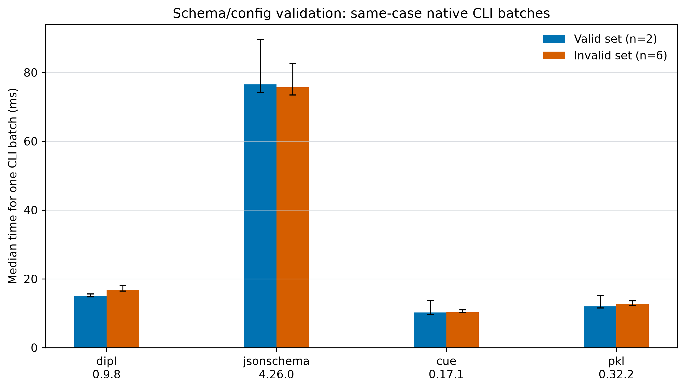

# Schema and configuration validation

This comparison maps documented validation features for DIPL, JSON Schema, CUE, and Pkl, then checks a shared set of valid and invalid scientific configuration examples before timing each tool's normal command-line workflow. Each feature entry links to primary documentation. The matrix is a documentation-based capability survey; its claims are separate from the executable results. Package versions and source links are recorded in [`config.dip`](config.dip).

## Feature support

| Feature | [DIPL](https://github.com/scinumtools/snt3/blob/main/docs/source/dipl/index.rst) | [JSON Schema](https://json-schema.org/learn/getting-started-step-by-step) | [CUE](https://cuelang.org/docs/) | [Pkl](https://pkl-lang.org/main/latest/language-reference/index.html) |
|---|---|---|---|---|
| Typed fields and nested structures | [Types, groups, maps, and lists](https://github.com/scinumtools/snt3/blob/main/docs/source/dipl/index.rst#structured-typed-values) | [Object and array schemas](https://json-schema.org/learn/getting-started-step-by-step) | [Structs and lists](https://cuelang.org/docs/tour/types/structs/) | [Typed objects and classes](https://pkl-lang.org/main/latest/language-reference/index.html#typed-objects) |
| Required and optional fields | [Declarations and schema members](https://github.com/scinumtools/snt3/blob/main/docs/source/dipl/index.rst#reusable-schemas) | [Required properties](https://json-schema.org/learn/getting-started-step-by-step#required-properties) | [Required and optional field constraints](https://cuelang.org/docs/tour/types/structs/) | [Typed properties and defaults](https://pkl-lang.org/main/latest/language-reference/index.html#type-defaults) |
| Enumerated or restricted values | [Options and conditions](https://github.com/scinumtools/snt3/blob/main/docs/source/dipl/index.rst#validation-metadata-and-provenance) | [Enums and const](https://json-schema.org/understanding-json-schema/reference/enum) | [Disjunctions and constraints](https://cuelang.org/docs/concept/how-cue-enables-data-validation/) | [Type constraints](https://pkl-lang.org/main/latest/language-reference/index.html#type-constraints) |
| Numeric bounds and string patterns | [Conditions and format properties](https://github.com/scinumtools/snt3/blob/main/docs/source/dipl/index.rst#validation-metadata-and-provenance) | [Numeric and string validation](https://json-schema.org/understanding-json-schema/reference/numeric) | [Bounds and regular expressions](https://cuelang.org/docs/concept/how-cue-enables-data-validation/) | [Type constraints](https://pkl-lang.org/main/latest/language-reference/index.html#type-constraints) |
| Rejecting undeclared fields | [Typed schema structures](https://github.com/scinumtools/snt3/blob/main/docs/source/dipl/index.rst#reusable-schemas) | [additionalProperties](https://json-schema.org/understanding-json-schema/reference/object#additional-properties) | [Closed structs](https://cuelang.org/docs/tour/types/closed/) | [Typed objects reject unknown properties](https://pkl-lang.org/main/latest/language-reference/index.html#typed-objects) |
| Cross-field rules and derived values | [Expressions, references, and conditions](https://github.com/scinumtools/snt3/blob/main/docs/source/dipl/index.rst#derived-values-and-decisions) | [Conditional schemas](https://json-schema.org/understanding-json-schema/reference/conditionals) | [Unification and constraints](https://cuelang.org/docs/concept/how-cue-enables-data-validation/) | [Expressions and type constraints](https://pkl-lang.org/main/latest/language-reference/index.html#type-constraints) |
| Defaults and reusable schema definitions | [Reusable schemas and overrides](https://github.com/scinumtools/snt3/blob/main/docs/source/dipl/index.rst#reusable-schemas) | [Reusable definitions](https://json-schema.org/understanding-json-schema/structuring) | [Definitions and unification](https://cuelang.org/docs/tour/types/structs/) | [Classes, modules, and defaults](https://pkl-lang.org/main/latest/language-reference/index.html#classes) |
| Physical units and dimensional validation | [Units and compatible modifications](https://github.com/scinumtools/snt3/blob/main/docs/source/dipl/index.rst#declarations-definitions-and-modifications) | Not part of the core JSON Schema validation vocabulary | Not identified in the cited core validation documentation | Not identified in the cited core type-constraint documentation |
| Field metadata and provenance | [Metadata and provenance](https://github.com/scinumtools/snt3/blob/main/docs/source/dipl/index.rst#validation-metadata-and-provenance) | [Annotations](https://json-schema.org/understanding-json-schema/reference/annotations) | [Documentation comments and attributes](https://cuelang.org/docs/) | [Doc comments](https://pkl-lang.org/main/latest/language-reference/index.html#doc-comments) |

“Not identified” means this comparison has not found equivalent support in the linked core documentation; it is not a claim that an extension or external library cannot provide it. The systems also differ in what they validate: JSON Schema commonly validates JSON instances against a schema, CUE can validate external JSON/YAML data, while Pkl evaluates typed configuration modules. Feature labels therefore describe a capability family, not necessarily identical semantics or APIs.

## Run

Install the pinned Python packages into the isolated environment with:

```sh
./setup.sh --benchmark schema-validation
```

The full comparison also requires the CUE `0.17.1` and Pkl `0.32.2` command-line tools on `PATH`. To run only the Python participants while setting up those tools, use `--participant dipl --participant jsonschema`. `--samples N` changes the number of timed batch invocations; `config.dip` controls the default participants, fixture selection, sample count, warmups, package pins, and output paths.

The fixture corpus has eight cases: two valid configurations and six invalid ones covering missing required fields, wrong types, enum restrictions, numeric bounds, a string pattern, and a nested bound. Cross-field constraints remain documented in the feature matrix, but are not timed until their semantics can be represented consistently across all participants. The runner writes generated participant inputs, an acceptance matrix, per-sample and summary CSVs, a figure, and an effective configuration snapshot under `results/`. Timings are collected only if every selected participant agrees with every expected result.

## Results

[Correctness matrix](results/schema_validation_20261024T205728Z_correctness.csv) · [Timing summary](results/schema_validation_20261024T205728Z_summary.csv) · [Per-sample timings](results/schema_validation_20261024T205728Z_samples.csv) · [Effective configuration](results/schema_validation_20261024T205728Z.config.json)



The correctness matrix runs each of the eight cases separately; all four participants matched the expected outcomes. For timing, each participant receives the same complete set of valid cases (two documents) or invalid cases (six documents) in a single native CLI invocation. The chart reports total time per batch, not per document, so comparisons are between tools within the same fixture class. It shows medians from 20 batches after three warmup batches. Error bars show the observed minimum and maximum, not confidence intervals.

Median batch times were 15.1 ms (DIPL), 76.6 ms (JSON Schema), 10.2 ms (CUE), and 12.0 ms (Pkl) for valid inputs; for invalid inputs they were 16.7 ms, 75.7 ms, 10.3 ms, and 12.7 ms, respectively. This is a more comparable measure of the complete CLI task: every tool validates the same documents, in one process per batch, with one startup cost per batch. It still measures each tool's runtime and CLI integration along with validation. In particular, JSON Schema's Python interpreter startup remains in the time, so these numbers do not establish that its validator is intrinsically slower. Treat this as a local end-to-end CLI comparison; repeated CI runs on a fixed runner are needed before making broad speed claims.

## Measurement and interpretation

Each timed operation starts one fresh process for a batch of either all valid or all invalid fixture files. This amortizes process startup over multiple documents and keeps the command count and document set identical across participants within each fixture class. Inputs use each tool's native format, and timing includes process startup, file reads, schema loading, validation, and diagnostic generation. This is an end-to-end CLI workload benchmark, not an in-process validator microbenchmark. The valid batch contains two documents and the invalid batch contains six; compare participant timings within a batch class rather than comparing valid and invalid bar heights directly.

The shared cases measure overlapping structural and constraint features. DIPL-only capabilities such as dimensional unit validation are intentionally outside the shared timing set. The feature matrix documents broader package capabilities, while the fixture acceptance matrix verifies only these eight concrete cases. A JSON Schema conformance suite is not used to grade CUE, Pkl, or DIPL.

## Sources and method

The suite takes the language-agnostic correctness focus of the official [JSON Schema Test Suite](https://github.com/json-schema-org/JSON-Schema-Test-Suite) as a reference for explicit expected outcomes, while following the stage separation described by [Schema Benchmarks](https://github.com/open-circle/schema-benchmarks). Neither is a ready-made cross-language suite for all four systems: the former defines JSON Schema behavior, and the latter focuses on JavaScript and TypeScript libraries.
