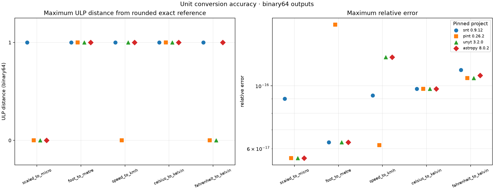

# Unit conversion accuracy

This benchmark measures the binary64 rounding error produced by SNT3, Pint,
unyt, and Astropy for the same five unit conversions. It is a correctness and
numerical behavior study, not a runtime ranking. Library versions, input values,
case definitions, tolerances, output settings, and reference precision are
controlled by [`config.dip`](config.dip), which the runner parses as DIPL.

## Cases

Each case is evaluated at every configured input, including negative values,
zero, values near zero, and a larger magnitude.

| Case ID | Conversion and reference rule |
|---|---|
| `scaled_to_micro` | metres to micrometres, exact factor 1,000,000 |
| `foot_to_metre` | international feet to metres, exact factor 381/1,250 |
| `speed_to_kmh` | metres per second to kilometres per hour, exact factor 18/5 |
| `celsius_to_kelvin` | Celsius temperature point to kelvin, offset 273.15 |
| `fahrenheit_to_kelvin` | Fahrenheit temperature point to kelvin, `(°F + 459.67) × 5/9` |

Each configured input is represented by its exact binary rational value, and
all conversion factors and offsets are exact rational numbers. The reference is
therefore calculated exactly, then rounded once to IEEE 754 binary64 for the
ULP comparison. The CSV also stores the exact reference fraction and the
absolute and relative error against that exact value. Cases with a zero
reference have undefined relative error and are judged using absolute error
and ULP distance. The method uses Python's built-in
[`fractions.Fraction`](https://docs.python.org/3/library/fractions.html), which
preserves the exact rational value of a binary float and supports rational
arithmetic.

The reported error metrics are the standard absolute, relative, and ULP
measures described in the [FPBench Measures specification](https://fptalks.org/spec/measures-1.2.html).
Unit definitions use the
[SI Brochure](https://www.bipm.org/en/publications/si-brochure) and the exact
international foot definition documented in [NIST SP 811](https://www.nist.gov/pml/special-publication-811).
NIST SP 811 predates the 2019 SI revision, so the SI Brochure is used for SI
definitions and SP 811 only for the international-foot relation.

## Results



The figure shows the largest error over the configured inputs in each case.
Markers are horizontally offset within each category so identical or nearly
identical library results remain visible; the offsets are visual only.
With SNT3 0.9.12 and the other pinned library versions, all participating outputs in this reference run are within one ULP of the
correctly rounded exact rational value. Maximum relative errors are on the
order of `10⁻¹⁶`, as expected for ordinary binary64 rounding in these
operations. This compact suite does not establish behavior for every unit,
custom definition, extreme overflow/underflow, or platform. The
[CSV](results/reference-quick.csv) contains every input/output comparison; the
[effective run configuration](results/reference-quick.config.json) records the
config hash and portable Python/platform labels.

## Running

```sh
./setup.sh --benchmark unit-conversion-accuracy --quick
```

Use `--case GLOB` and `--library NAME` repeatedly to select a subset. For
example, `--case '*temperature*' --library snt` selects SNT temperature
conversions. Pass `--python PATH` to use a prepared environment. A run writes
timestamped CSV, figure, and configuration files; `--quick` also refreshes the
tracked reference snapshot. Automatic retention keeps the newest ten timestamped
result sets.

## References

- FPBench, [Measures Specification 1.2](https://fptalks.org/spec/measures-1.2.html).
- BIPM, [The International System of Units (SI Brochure)](https://www.bipm.org/en/publications/si-brochure).
- NIST, [Guide for the Use of the International System of Units (SP 811)](https://www.nist.gov/pml/special-publication-811).
- Python, [`fractions.Fraction`](https://docs.python.org/3/library/fractions.html).
